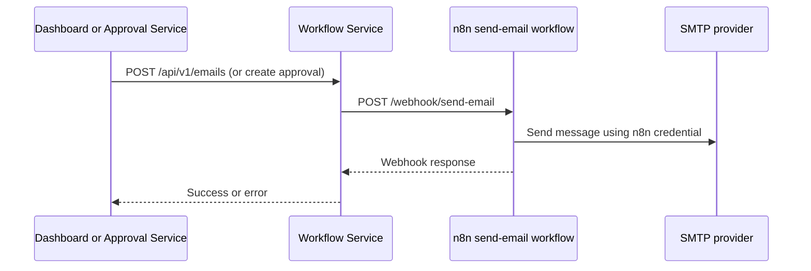

# Email Workflow Architecture

The email workflow is an n8n integration used by the dashboard's **Send Email** action and by approval-request notifications. It is separate from business workflows and is normally provisioned once per n8n instance.

## Runtime flow



The setup endpoint `POST /api/v1/setup/email-workflow` creates or reuses and activates the workflow. It does **not** send an email. The dashboard's **Create Workflow → Send Email** action provisions/reuses it and then sends a message. Approval creation triggers the same email webhook after sending the separate `approval.requested` event.

## Generated workflow nodes

The setup use case creates this structure:

```text
Webhook Trigger (POST /webhook/send-email; respond immediately)
    ↓
Send Email (SMTP credential attached)
    ↓
Respond to Webhook
```

The generated Send Email node uses the configured credential reference from `N8N_SMTP_CREDENTIAL_ID` and `N8N_SMTP_CREDENTIAL_NAME`; `N8N_SMTP_SENDER` supplies the sender address. Create the actual SMTP credential in n8n first. Environment variables alone do not create or populate an n8n node credential.

The payload accepts top-level fields, as used by the service, and supports n8n webhook body mapping:

| Field       | Meaning                   |
| ----------- | ------------------------- |
| `to`        | Recipient string or array |
| `subject`   | Message subject           |
| `body`      | Plain-text message        |
| `html`      | Optional HTML body        |
| `cc`, `bcc` | Optional recipient lists  |
| `replyTo`   | Optional reply address    |

The generated node maps the webhook body with top-level fallbacks, for example `={{ $json.body?.subject ?? $json.subject }}`. The setup endpoint requires a configured credential ID and fails early if it is missing.

## Manual configuration

If you build the workflow manually in n8n:

1. Add a Webhook node using method `POST` and path `send-email`.
2. Add a Send Email node and select the SMTP credential created in n8n.
3. Map recipient, subject, and body from the Webhook node input; support `$json.body` and top-level payload fields if you need to match the service contract.
4. Add a Respond to Webhook node or configure immediate response.
5. Save and activate the workflow.

Use the setup guide for configuration and verification steps: [Email Setup Guide](../setup/email-setup.md).

> Do not put SMTP passwords, API keys, or other credentials in this document, workflow JSON committed to source control, or frontend code. Keep this local POC on trusted networks only.
