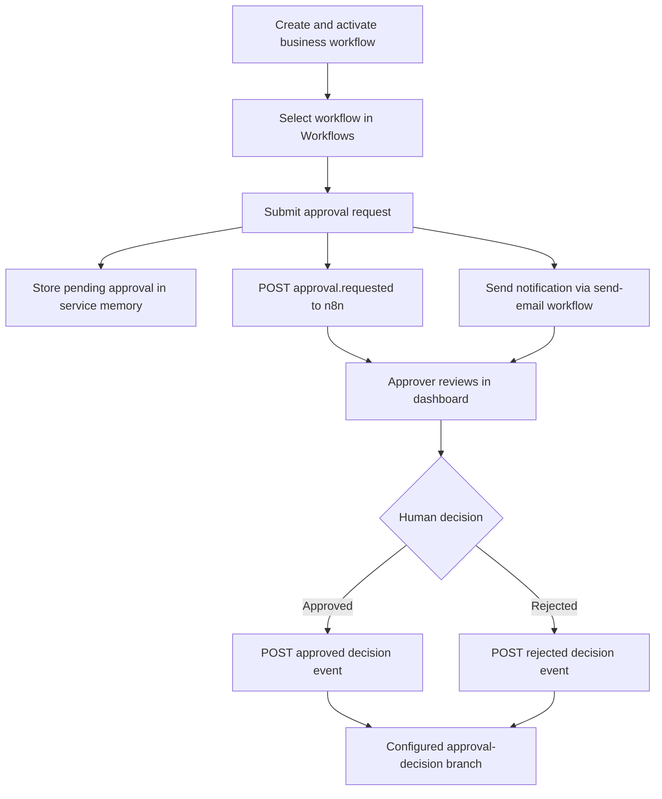

# End-to-End Business Flow (POC)

This guide describes what the dashboard and workflow service currently do, what must be configured in n8n, and what this POC does **not** automate.

## At a glance

The selected business workflow ID is **correlation metadata** on the approval. Creating or deciding an approval does not attach a node to, pause, resume, or automatically execute that selected workflow. The `approval-decision` webhook starts a separate n8n execution. Configure that workflow to route the event and perform any desired business action.

## Workflow IDs and webhook paths

These are different identifiers:

- **Workflow ID**: n8n's ID for the saved workflow, shown in the Workflows tab and returned by workflow-creation APIs. Approval records use this ID as a reference.
- **Webhook path**: a string configured on an n8n Webhook node, used in a URL such as `http://localhost:5678/webhook/approval-decision`. It selects the registered trigger, not the workflow record by ID.

The approval service posts to configured paths such as `approval-request`, `approval-decision`, and `ai-decision`. Those integration paths are not the business workflow ID selected in the approval form.

## One-time prerequisites

1. Start n8n and the workflow service; open the dashboard at `http://localhost:5173`.
2. Configure and activate these integration workflows in the same n8n instance used by the service:
   - `approval-request` — receives request events.
   - `send-email` — sends approval notifications and has a valid n8n SMTP credential.
   - `approval-decision` — receives human decisions.
   - `ai-decision` — receives advisory AI events, when using AI Review.
3. Set webhook paths to match the workflow service environment variables. Defaults are `approval-request`, `approval-decision`, and `ai-decision`.
4. Configure an AI provider and its billing/usage access if testing AI Review. The provider key stays in the server environment, not the browser.
5. In `approval-decision`, configure a Switch/IF node to branch on `{{$json.body.decision ?? $json.decision}}`. Use harmless test actions (such as Set nodes) until the flow is verified.

The integration workflows above are separate from business workflows created in the dashboard. Setup endpoints for standard workflows are documented in [Workflow Setup via API](../setup/workflow-setup-api.md).

## Sample case: purchase request over policy threshold

Use test data and a monitored email address. Do not connect this demonstration to a real purchasing action.

### 1. Create a business workflow

In **Create Workflow**, create a webhook or scheduled business workflow such as `purchase-approval-demo`. Confirm that it is active in **Workflows**. These starter workflows have their own trigger and are not approval-gated.

### 2. Run AI Review (optional Phase 3 path)

In **AI Review**, select `purchase-approval-demo` and submit:

- **Business request:** `Please review a request to purchase five keyboards at $120 each for the support team. Total: $600.`
- **Policy context:** `Purchases over $500 require manager approval. Do not place an order before approval.`

The model may return `approve`, `reject`, or `needs_review`; the result is advisory and does not determine the human decision. A successful provider request returns a validated recommendation. A successful n8n handoff reports `dispatchStatus: dispatched`. If only the handoff fails, the dashboard can retry it without another model call.

### 3. Create and notify the approval

From the AI result, enter a requester and real, monitored approver address, then choose **Create human approval request**. Alternatively, in **Workflows**, choose **Create linked approval** for the business workflow, fill out the approval form, and submit it.

The service:

1. Creates an approval record with its own `approvalId`, the selected `workflowId`, request details, and `status: pending`.
2. Sends `event: approval.requested` to the `approval-request` webhook.
3. Sends the approver an email through `send-email`.

The approval inbox shows the selected workflow association. The email is a notification, not an approve/reject link; decisions are made in the dashboard.

### 4. Record the human decision

Choose **Approve** or **Reject** in **Approvals**. The service records the terminal decision and sends `event: approval.decision` with the `approvalId`, `workflowId`, decision, and related request metadata to the `approval-decision` webhook.

The configured n8n decision workflow should branch to a safe test action. Only an approved decision sets `canContinue: true`; this is a service state flag, not proof that the business workflow ran. Rejection remains a recorded decision and should follow the rejection branch.

### 5. Verify the run

- In **Approvals**, confirm the request status, notification status, continuation status, and workflow association.
- In n8n **Executions**, confirm the request, email, and decision executions and inspect the decision branch.
- In **Execution Logs**, confirm recent n8n execution summaries appear. The UI polls `/api/v1/logs` every three seconds; the endpoint returns up to 100 executions without execution data.

## Event handoff overview

- `approval.requested` goes to `N8N_APPROVAL_REQUEST_WEBHOOK_PATH`.
- `approval.decision` goes to `N8N_APPROVAL_DECISION_WEBHOOK_PATH`.
- `ai.decision` goes to `N8N_AI_DECISION_WEBHOOK_PATH`.
- Email is a separate POST to `/webhook/send-email`.

Request and decision events start separate n8n executions; they do not resume one suspended run. Use `approvalId` as an idempotency key for downstream side effects. AI events are advisory and must not perform business-changing actions before human approval.

## Known POC limitations and failure handling

- Approval, AI retry, and gateway state are in process memory and are lost when the workflow service restarts.
- The service has no authentication. The dashboard submits the stored approver email as the decision actor; this does not prove that the reviewer owns that address.
- Approval request bodies are exposed through the unauthenticated `/api/v1/states` endpoint. When an AI result is turned into an approval, its request and recommendation are copied into that approval body. Do not submit secrets or sensitive personal data, and do not expose this service publicly.
- If the request webhook succeeds but email delivery fails, the create call returns an error and there is no dedicated notification retry control. Check n8n Executions and approval state before trying again to avoid duplicate work.
- A failed decision handoff remains recorded and can be retried by resubmitting the same decision. Downstream workflows should be idempotent because network failures can make delivery outcomes ambiguous.
- The generated integration webhook workflows are starter receivers. Add and test the n8n branches/actions required by the business process.
- The API key/usage for an external AI provider is separate from ChatGPT subscriptions. Local OpenAI-compatible servers may be used if configured to support the request format.

This is a demonstration POC, not a production approval or audit system. Durable storage, authenticated reviewer identity, authorization, secure secret management, and a true pause/resume orchestration design remain production requirements.
