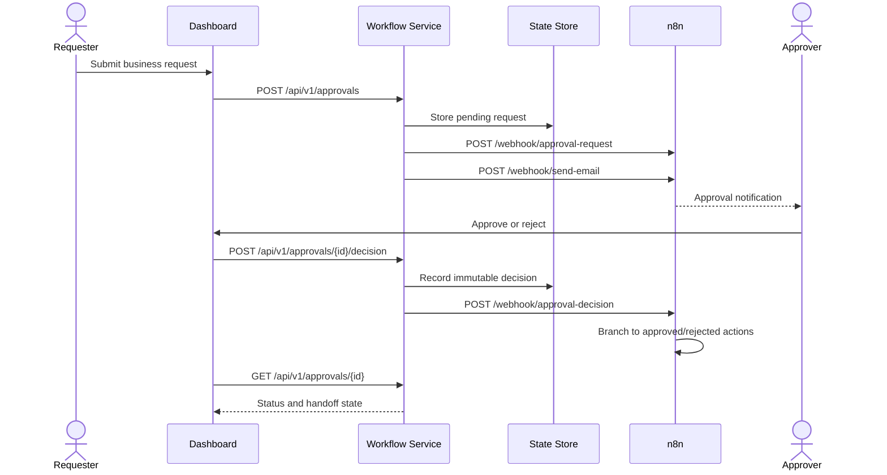

# System Architecture & Flow Diagrams

This document contains visual diagrams mapping out the automation gateway architecture, execution workflows, and webhook lifecycles.

## Gateway Architecture

The following diagram illustrates how the Hono API behaves as an orchestrator between client applications and n8n:

```
                 Client Application
                         │
                         ▼
                Hono REST API
                         │
         ┌───────────────┼───────────────┐
         ▼               ▼               ▼
  Workflow API       Logging        State Store
         │
         ▼
      n8n Service Layer
         │
         ▼
         n8n REST API
         │
         ▼
      Workflow Execution
```

---

## Workflow Creation and Execution Monitoring

The service creates or activates a workflow through the n8n API; n8n executes it later when its own trigger fires. The gateway does not update an execution log as a side effect of creating or activating a workflow. The dashboard fetches n8n execution summaries separately.

```
Dashboard ──POST create──> Workflow Service ──n8n REST API──> n8n saves workflow
                                            │
                          trigger fires later ─────────┘
                                            ▼
                                        n8n execution

Dashboard ──GET /api/v1/logs──> Workflow Service ──GET /api/v1/executions──> n8n
Dashboard ──GET /api/v1/states──> Workflow Service in-memory state
```

---

## Example Webhook Integration Workflow

Visualizing how dynamic webhook paths are caught and delegated to n8n:

```
Webhook Event
    │
    ▼
Hono API Endpoint
    │
    ▼
Trigger n8n Workflow Webhook
    │
    ▼
n8n Workflow Execution
    │
    ▼
Record gateway-local forwarding status
    │
    ▼
Client Response
```

---

## Human-in-the-Loop Business Approval Workflow

The dashboard creates a request associated with a selected business workflow ID. This is correlation metadata: it does not attach a node to, pause, or resume the selected workflow. The service triggers an n8n request workflow and the separate `send-email` workflow. A reviewer makes a decision in the dashboard; the service records it and starts a separate decision workflow. That workflow must be configured to branch and perform the desired approved/rejected action. No decision link is included in the notification email.



### Approval and Handoff States

```text
                ┌───────────┐
                    │  pending  │
                    │ canContinue=false
                └─────┬─────┘
                    │
            ┌───────────┴───────────┐
            ▼                       ▼
       ┌─────────────┐         ┌─────────────┐
      │  approved   │         │  rejected   │
      │ canContinue=true      │ canContinue=false
       └─────────────┘         └─────────────┘
```

The decision is terminal once dispatched. If n8n handoff fails, the decision remains recorded with `continuationStatus: failed`; the same decision can be retried from the dashboard. Downstream n8n actions should use `approvalId` for idempotency. If the request webhook succeeds but email delivery fails, the create call returns an error and there is no request/email retry control. Approval records are in-memory and include the request body; the unauthenticated `/api/v1/states` route exposes them.

`canContinue` describes the recorded approval outcome; it does not itself block or release execution of the selected business workflow.

---

## AI-Assisted Triage and Human Approval

Phase 3 calls a server-configured model, validates its advisory recommendation, and dispatches the result to n8n. The dashboard can then create a Phase 2 approval, keeping the human decision as the business-action gate. When an approval is created from an AI result, the request and recommendation are copied into the approval body.

```mermaid
sequenceDiagram
    actor Requester
    participant UI as Dashboard
    participant API as Workflow Service
    participant AI as Configured AI Provider
    participant Store as In-memory State
    participant N8N as n8n
    actor Approver
    Requester->>UI: Submit business request and policy context
    UI->>API: POST /api/v1/ai/decisions
    API->>AI: Analyze request using server-side credentials
    AI-->>API: Structured recommendation and risk
    API->>API: Validate constrained response
    API->>Store: Store status and route metadata only
    API->>N8N: POST /webhook/ai-decision (ai.decision)
    N8N->>N8N: Branch on recommendation and risk
    API-->>UI: Recommendation; humanReviewRequired=true
    UI->>API: POST /api/v1/approvals
    API->>N8N: POST /webhook/approval-request
    API->>N8N: POST /webhook/send-email
    N8N-->>Approver: Approval notification
    Approver->>UI: Approve or reject
    UI->>API: POST /api/v1/approvals/{id}/decision
    API->>N8N: POST /webhook/approval-decision
    N8N->>N8N: Configured decision flow routes using workflowId and decision
```

The provider call is server-side; the API key is not sent to the browser. A failed n8n AI-event handoff can be retried using the stored decision ID without repeating the model call. AI output is untrusted and advisory; its n8n branches are for routing/review preparation only. Business-changing side effects must wait for the Phase 2 human approval event.

## Execution Logs and State

`GET /api/v1/logs` asks n8n for up to 100 executions with execution data excluded; the UI polls this endpoint every three seconds. `GET /api/v1/states` is a different API backed by process memory and returns gateway state such as approvals and webhook status. Neither endpoint provides durable audit storage, and the log view is polling rather than push-based real-time streaming.
