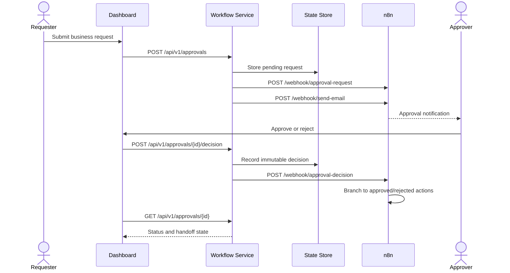

# System Architecture & Flow Diagrams

This document contains visual diagrams mapping out the automation gateway architecture, execution workflows, and webhook lifecycles.

## Gateway Architecture

The following diagram illustrates how the Hono API behaves as an orchestrator between client applications and n8n:

```
                 Client Application
                         │
                         ▼
                Hono REST API
                         │
         ┌───────────────┼───────────────┐
         ▼               ▼               ▼
  Workflow API       Logging        State Store
         │
         ▼
      n8n Service Layer
         │
         ▼
         n8n REST API
         │
         ▼
      Workflow Execution
```

---

## Workflow Lifecycle

The typical path from a client request down to log updates and state updates:

```
Client Request
      │
      ▼
Hono API
      │
      ▼
Validate Request
      │
      ▼
Call n8n REST API
      │
      ▼
Execute Workflow
      │
      ▼
Update Logs
      │
      ▼
Update Workflow State
      │
      ▼
Return Response
```

---

## Example Webhook Integration Workflow

Visualizing how dynamic webhook paths are caught and delegated to n8n:

```
Webhook Event
    │
    ▼
Hono API Endpoint
    │
    ▼
Trigger n8n Workflow Webhook
    │
    ▼
n8n Workflow Execution
    │
    ▼
Log Execution Status
    │
    ▼
Client Response
```

---

## Human-in-the-Loop Business Approval Workflow

The dashboard starts a business request. The workflow service triggers an n8n request workflow and sends the approver an email. A reviewer makes a decision in the dashboard; the service records it and starts a separate n8n decision workflow, which branches to the approved or rejected business path. This event-driven design does not keep an n8n execution suspended while waiting.



### Approval and Handoff States

```text
                ┌───────────┐
                    │  pending  │
                    │ canContinue=false
                └─────┬─────┘
                    │
            ┌───────────┴───────────┐
            ▼                       ▼
       ┌─────────────┐         ┌─────────────┐
      │  approved   │         │  rejected   │
      │ canContinue=true      │ canContinue=false
       └─────────────┘         └─────────────┘
```

The decision is terminal once dispatched. If n8n handoff fails, the decision remains recorded with `continuationStatus: failed`; the same decision can be retried from the dashboard. Downstream n8n actions should use `approvalId` for idempotency.
